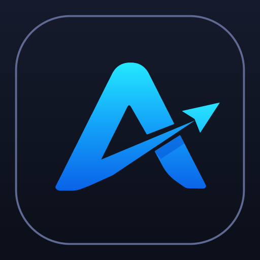

<div align="center">



# ArenaPilot

**An independent Android client for [arena.ai](https://arena.ai) Direct Chat, with an agent engine built in.**

*অ্যারেনাপাইলট — arena.ai Direct Chat-এর জন্য একটি স্বতন্ত্র অ্যান্ড্রয়েড অ্যাপ।*

[](https://github.com/themuhammad-personal/Arenapilot/releases/latest/download/arenapilot-latest.apk)

[](https://github.com/themuhammad-personal/Arenapilot/actions/workflows/build-and-release-apk.yml)

[](LICENSE)

</div>

> [!IMPORTANT]
> ArenaPilot is an **independent, unofficial** project. It is not affiliated with, endorsed by or
> sponsored by arena.ai. You use arena.ai through its own website, under its own terms and privacy policy.

## Identity

ArenaPilot opens the real arena.ai page — your own account and sign-in — and adds an engine on top of
it. The original Arena page is the only chat surface: there is no second composer and no replacement
model picker. **Direct Chat is the supported mode.** Battle, Side-by-side and Agent mode stay the
untouched official pages.

## What it does

| Direct Mode page | What the engine does |
|---|---|
| **Text** `/text/direct` | Full agent engine: Linux sandbox, MCP tools, memory, projects |
| **Code** `/code/direct` | Same engine, plus Code rules: complete runnable code, run and check in the sandbox before answering |
| **Search** `/search/direct` | Same engine, plus Search rules: use live search, cite sources, cross-check what matters |
| **Image** `/image/direct` | The engine stays out of the way — your prompt reaches the image model exactly as typed |

Core capabilities, all in Direct Mode:

- **Agent playbook** — every conversation carries rules for persistence, evidence over guesswork, plan → act → verify,
  working inside chat limits, resumable progress files and honest completion.
- **Linux sandbox** — a private Alpine Linux (proot) where the model writes, runs and fixes code. Linux Studio gives a
  terminal, file browser and preview.
- **MCP servers** — connect tools; the model finds and calls them.
- **Memory and projects** — stored memory (opt-in, off by default) and per-chat projects with files.
- **Reliable long tasks** — arena's stream is read directly; rate limits, dropped streams and cut-off replies trigger a bounded,
  Stop-respecting recovery instead of silently ending the task.
- **Files** — upload images, files and project folders from the **+** sheet.
- **Phone-first skin** — the official page, styled in place for touch screens.

## Install

1. Download **[arenapilot-latest.apk](https://github.com/themuhammad-personal/Arenapilot/releases/latest/download/arenapilot-latest.apk)** on Android 8.0+.
2. Open it and allow installing from this source.
3. Sign in with your arena.ai account.

Every build is signed with the same key, so new versions install as updates.

## How it is built

```
Android app (Kotlin)
 ├─ WebView ─▶ https://arena.ai        the real page, styled for mobile
 │     └─ engine injected on every load (android/app/src/main/bds-assets/bds)
 │          sd-site.js     site profile, Direct modalities, app instructions
 │          injected.js    request layer: context, memory, tool results
 │          content.js     settings, commands, cards, tool runner
 │          sd-agent.js    agent loop: Stop, keep-going, recovery
 ├─ AndroidBridge ⇄ storage, pickers, downloads, sandbox
 └─ Linux sandbox: proot + Alpine · foreground service
```

The app never needs an API key, never bypasses a login or captcha, and only sends through the page's own composer.

## Develop

```bash
npm ci
npm test                         # engine, release-hygiene and model-list tests
cd android && ./gradlew testDebugUnitTest assembleDebug
```

GitHub Actions builds, tests and verifies the APK on every push; the release job publishes it from `main`.
The plan is in [docs/PLAN.md](docs/PLAN.md), the running state in [docs/PROGRESS.md](docs/PROGRESS.md), and the
new-chat setup guide in [docs/PROJECT-SETUP.html](docs/PROJECT-SETUP.html).

## License

[MIT](LICENSE)
