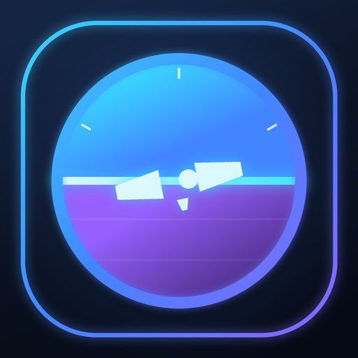

<div align="center">



# ArenaPilot

**An independent, native Android companion for [arena.ai](https://arena.ai) Direct Chat — with an AI agent that has its own Linux computer.**

AI agent · Linux Studio · model picker · thinking chips · MCP tools · Deep Research

[](https://github.com/themuhammad-personal/Super-Deepseek-/releases/download/arena-latest/arenapilot-latest.apk)
&nbsp;
[](https://github.com/themuhammad-personal/Super-Deepseek-/releases/tag/arena-latest)

[](https://github.com/themuhammad-personal/Super-Deepseek-/actions/workflows/build-and-release-apk.yml)

[](LICENSE)

</div>

---

> [!IMPORTANT]
> ArenaPilot is an **independent, unofficial** project. It is **not** affiliated with, endorsed
> by or sponsored by arena.ai. You use arena.ai through its own website, under its own terms
> and privacy policy. The app says so once, on first launch.
> অ্যারেনাপাইলট একটি স্বতন্ত্র, অনানুষ্ঠানিক অ্যাপ — arena.ai-এর সঙ্গে এর কোনো সম্পর্ক নেই।

## Why ArenaPilot?

ArenaPilot opens **the real arena.ai** — your own account, your own sign-in, real models — and
adds tools, memory, an AI agent with its own Linux sandbox, and a mobile-first skin to that
same official page. **The original Arena page is the only chat surface**: there is no parallel
Compose chat shell, second composer, or replacement model picker. Direct Chat is the supported
mode; Battle / Side-by-side / Agent mode pages stay untouched.

| | |
|---|---|
| 🤖 **It gets work done** | The AI has its own Linux computer. It writes, runs, tests and fixes code on its own until the task is done, and **Stop** is always one tap away. |
| 🐧 **Linux in your pocket** | Linux Studio gives you a terminal, a file browser and a live preview of what the AI builds. |
| 🧠 **It remembers you** | Memory, personas and multiple system prompts, applied to every chat automatically. |
| ⚡ **Type less** | Type `/` for built-in commands and your own snippets. |
| 🔌 **Plug in tools** | Connect MCP servers, and the AI finds and calls their tools by itself. |
| 🔎 **Research deeply** | Multi-step Deep Research with page fetching, source ranking and a context guard. |
| 📱 **A phone-first Arena page** | The real Arena composer, model picker, reasoning and messages stay on the official page, styled in place for touch screens; the Android shell adds device integration and Linux Studio. |

## The in-place mobile redesign (N0 in progress)

The first generation showed the website as-is and the owner's complaints (settings buried,
model names pushing Send off-screen, thinking mixed into answers) came from that. A first N0
attempt put a separate Compose chat shell OVER the hidden page — the owner rejected it
(2026-10-15): **arena's official interface itself is to be made Android-native and beautiful**,
not shadowed by a parallel UI. That shell was removed; the page is again the app's face, now
to be reshaped in place:

- **N0 — the official interface, styled native:** an injected mobile-first Material-3 skin
  over the real arena.ai UI (colors, typography, spacing, composer, sheets) — the page stays
  the real page: your login, recaptcha and the engine all keep working.
- **N1 — step cards** for tool calls and results, so tags never show as raw text.
- **N2 — sandbox, files and Computer view** surfaced natively.
- **N3 — background runs** with a foreground service and notifications.
- **N4 — MCP, research and the full Manus-level deliverable set.**

The plan with acceptance criteria for every phase is in
[docs/arena/ROADMAP-4-BN.md](docs/arena/ROADMAP-4-BN.md) (Bengali, as the owner wrote it).

## Install

1. Download **[arenapilot-latest.apk](https://github.com/themuhammad-personal/Super-Deepseek-/releases/download/arena-latest/arenapilot-latest.apk)**
   on your phone (Android 8.0+).
2. Open it and allow installing from this source when Android asks.
3. Sign in with your arena.ai account. That's it.

Every build is signed with the same key, so new versions install as updates.

## FAQ

<details>
<summary><b>Is this an official arena.ai app?</b></summary>

No. ArenaPilot is an independent, unofficial project and is not affiliated with, endorsed by or
sponsored by arena.ai. It shows arena.ai's own website (Direct Chat), so you sign in with your
normal arena.ai account and arena.ai's own terms and privacy policy apply.
</details>

<details>
<summary><b>Which modes work?</b></summary>

Direct Chat. Battle, Side-by-side and Agent mode pages show a notice and are not modified.
</details>

<details>
<summary><b>Do I need an API key?</b></summary>

No. Chatting works through the website with your own account.
</details>

<details>
<summary><b>What does the app send?</b></summary>

Your messages and, by default, app instructions (skills, characters, projects, tool
definitions) go to arena.ai and the provider of the model you picked. **Stored memory is a
separate, OFF-by-default opt-in.** Both switches live in *Advanced settings → Chat & messages*,
and the first-launch notice explains exactly this.
</details>

<details>
<summary><b>How big is the Linux sandbox?</b></summary>

The base Alpine system is only a few MB and is downloaded on first use. Packages you or the AI
install take extra space. The *Linux & Agent* page shows the free space, and *Reset Linux*
deletes everything.
</details>

## How it works

```
Android app (Kotlin)
 ├─ WebView ─▶ https://arena.ai           the app's face: the real page, styled native (N0)
 │     └─ engine injected on every load
 │          injected.js      network layer: context, memory, tool results
 │          content.js       settings, commands, cards, tool runner
 │          sd-agent.js      the agent: Linux tools, Stop, keep-going, scroll guard
 │          sd-sheets.js     draggable sheets and drawers
 ├─ AndroidBridge ⇄ storage, pickers, downloads, haptics, updates, sandbox
 └─ Linux sandbox: proot + Alpine (/root/workspace) · Linux Studio · foreground service
```

You always talk to the real arena.ai site — the app never needs an API key, never bypasses a
login or captcha, and only ever sends through the page's own composer. The model calls a tool
by writing a tag; the engine runs it (for example a command in the Linux sandbox) and feeds the
result back as the next message. The full design is in
[docs/ARCHITECTURE.md](docs/ARCHITECTURE.md).

## Build from source

```bash
npm ci
npm run test:template && npm run test:engine   # checks
npm run android:stage-engine          # copy the engine into the APK assets
python3 scripts/fetch_sandbox_deps.py # proot + libraries for the Linux sandbox (optional)
cd android && ./gradlew testDebugUnitTest assembleRelease
```

Without the sandbox step the app still builds and works, just without Linux.
CI ([build-and-release-apk.yml](.github/workflows/build-and-release-apk.yml)) runs the same
steps, boots the real APK on an API-34 emulator, reads the real arena.ai page over DevTools,
verifies the APK signature and publishes every build to the
[`arena-latest`](https://github.com/themuhammad-personal/Super-Deepseek-/releases/tag/arena-latest)
release channel. What is verified and what is still unknown is in
[docs/arena/REPORT-BN.md](docs/arena/REPORT-BN.md).

<details>
<summary><b>Project layout</b></summary>

<br>

| Path | What lives there |
|---|---|
| `android/app/src/main/java/com/superdeepseek/app/` | Kotlin shell: `MainActivity`, `WebViewBridge`, the sandbox (`Sandbox`, `SandboxTools`, `SandboxService`) and Linux Studio (`StudioActivity`, `StudioPreview`). The Kotlin namespace is historical; the app's id is `com.arenadeck.app`. |
| `android/app/src/main/bds-assets/bds/` | The engine bundle (`content.js`, `injected.js`, `sd-agent.js`, styles, sandbox pages) |
| `android/app/src/test/` | JVM unit tests (`java/`) and engine tests (`js/`) |
| `docs/` | Architecture notes, the roadmap and third-party licenses |
| `scripts/` | Build helpers: `fetch_sandbox_deps.py` for the sandbox runtime, `bds-sync.sh` for upstream diffs (dry run by default) |

</details>

## Privacy

ArenaPilot has no servers and no analytics. Your chats go to arena.ai and the model provider,
exactly as when you use the website yourself. Memory, prompts, snippets, settings and your
Linux files stay on your device.

The app only contacts other services when a feature needs them:

- GitHub Releases for update checks;
- the Alpine mirrors when Linux is first set up or a package is installed;
- MCP servers, websites and GitHub, but only the ones you or the AI choose to use.

## Contributing

Issues and pull requests are welcome, especially bug reports with screenshots, and new commands
or tools. [Open an issue →](https://github.com/themuhammad-personal/Super-Deepseek-/issues/new)

## License

[MIT](LICENSE). ArenaPilot is an independent project and is not affiliated with arena.ai.

- **Fonts:** the launch screen uses the [Sora](https://github.com/sora-xor/sora-font) typeface
  and the Linux Studio terminal uses [JetBrains Mono](https://github.com/JetBrains/JetBrainsMono).
  Both are under the SIL Open Font License 1.1
  ([Sora](docs/licenses/Sora-OFL.txt), [JetBrains Mono](docs/licenses/JetBrainsMono-OFL.txt)).
- **Linux sandbox:** built from unmodified open-source parts (PRoot, talloc and more under GPL,
  LGPL and BSD licenses). See [SANDBOX-NOTICE.md](docs/licenses/SANDBOX-NOTICE.md).

---

<div align="center">
<sub>
Thanks to <a href="https://github.com/EdgeTypE/better-deepseek"><b>Better DeepSeek</b></a> by Çağrı DÜRÜ.
This project's engine began as that open-source extension. 💙
</sub>
</div>
