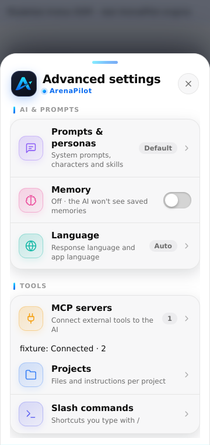
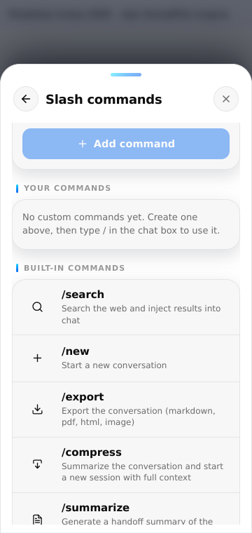
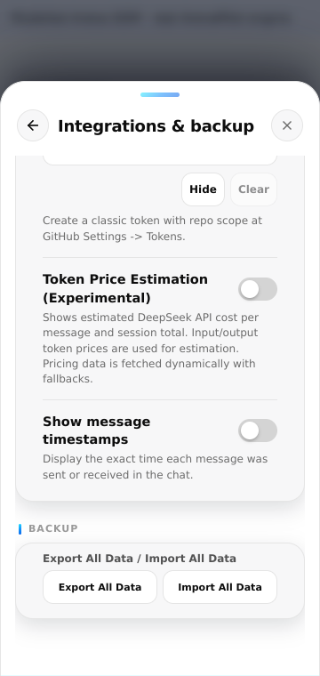
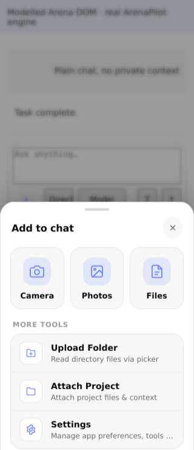
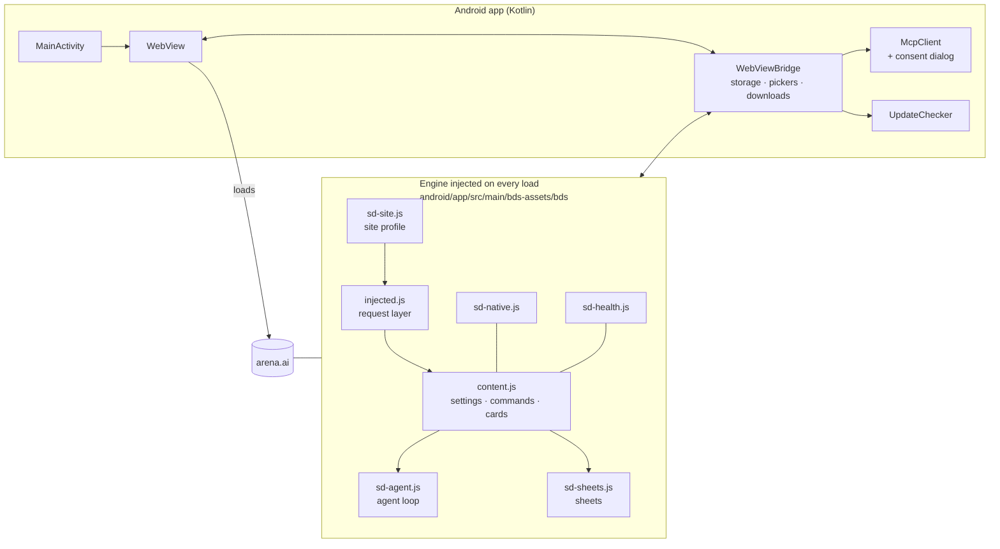

<div align="center">


# ArenaPilot

**An independent Android client for [arena.ai](https://arena.ai) Direct Chat, with an agent engine built in.**

*অ্যারেনাপাইলট — arena.ai Direct Chat-এর জন্য একটি স্বতন্ত্র অ্যান্ড্রয়েড অ্যাপ।*

[](https://github.com/themuhammad-personal/Arenapilot/releases/latest/download/arenapilot-latest.apk)

[](https://github.com/themuhammad-personal/Arenapilot/actions/workflows/build-and-release-apk.yml)

[](LICENSE)

</div>

> [!IMPORTANT]
> **ArenaPilot is an independent, unofficial project.** It is not affiliated with, endorsed by or
> sponsored by arena.ai or any model provider. You use arena.ai through its own website, under its
> own terms and privacy policy.

## Screens

<div align="center">




</div>

<sub>Captured from the real engine bundle running in headless Chromium on a *modelled* Arena page
(`tools/harness/fixture/arena.html`) — not from a physical device and not from the live arena.ai site.</sub>

## What it is

ArenaPilot opens the real arena.ai page — your own account and sign-in — and adds an engine on top of
it. The original Arena page is the only chat surface: there is no second composer and no replacement
model picker. **Direct Chat is the supported mode.** Battle, Side-by-side and Agent mode stay the
untouched official pages.

| Direct Mode page | What the engine does |
|---|---|
| **Text** `/text/direct` | Configured MCP tools, opt-in memory and projects |
| **Code** `/code/direct` | Arena’s Code page and its own preview when offered; no device shell |
| **Search** `/search/direct` | Same engine, plus search rules: use live search, cite sources, cross-check what matters |
| **Image / Video** | The engine stays out of the way — your prompt reaches the model as typed |

## Features

- **Agent playbook** — each conversation carries rules for persistence, evidence over guesswork,
  plan → act → verify, and honest completion. It can be switched off in *Chat & messages*.
- **MCP servers** — connect remote tools; the model discovers and calls them, and every tool call
  asks for your consent first.
- **Memory & projects** — stored memory is opt-in and **off by default**; per-chat projects carry
  files and instructions.
- **Prompts & personas** — system prompts, characters and skills in one place.
- **Slash commands** — type `/` in the composer for built-in commands (`/search`, `/new`, `/export`,
  `/compress`, `/summarize`, …) and create your own from *Advanced settings → Slash commands*.
- **Custom CSS** — restyle the chat from *Advanced settings → Custom CSS*.
- **Backup** — *Integrations & backup* exports and imports your settings and data.
- **Settings check-up** — *Run a check-up* reads the running engine and reports what works on this page.
- **Reliable long tasks** — rate limits, dropped streams and cut-off replies trigger a bounded,
  Stop-respecting recovery.
- **Files** — upload photos, files and project folders from the **+** sheet.
- **Languages** — English, বাংলা, فارسی, Русский, Türkçe, 简体中文.

## Install

1. Download **[arenapilot-latest.apk](https://github.com/themuhammad-personal/Arenapilot/releases/latest/download/arenapilot-latest.apk)** on Android 8.0+.
2. Open it and allow installing from this source.
3. Sign in with your arena.ai account.

Every release is signed with the same certificate, so new versions install as updates. A SHA-256
checksum (`arenapilot-latest.apk.sha256`) is published next to each APK.

## Architecture



The app never needs an API key, never bypasses a login or captcha, and only sends through the page’s
own composer.

## Develop

```bash
# Node 22 and JDK 17 (Android SDK 34)
npm ci
npm test                  # engine, release-hygiene, model-list tests
npm run lint
npm run test:harness:arena   # real engine in headless Chromium on a modelled Arena page
npm run android:stage-engine
cd android && ./gradlew testDebugUnitTest assembleDebug
```

Repository layout:

| Path | Contents |
|---|---|
| `android/` | Kotlin app, Gradle build, CI helper scripts (`android/ci`) |
| `android/app/src/main/bds-assets/bds/` | The engine (JS/CSS) injected into the page |
| `android/app/src/test/` | JVM unit tests and engine tests (`js/`) |
| `tools/harness/` | Headless-browser harness and Arena fixture |
| `models.json`, `models/` | Model list and its tests |
| `.github/workflows/` | Build, verify and release pipeline |

## Security notes

- ArenaPilot talks to arena.ai through its own web page; your sign-in stays in the app’s WebView.
- MCP tool calls require your explicit consent; remote MCP servers are yours to choose and trust.
- Tool output, fetched pages and files are treated as untrusted data by the engine’s instructions.
- Release APKs are signed with the project's original key, which lives only in GitHub Secrets (never in the repository). CI pins the published certificate fingerprint (SHA-256 `ffdd6e6a…8383c`), so a build signed with any other key cannot ship and updates install over existing installs.
- Stored memory is off by default; enabled context is sent to arena.ai and your chosen model provider.

## License

[MIT](LICENSE). The engine builds on the MIT-licensed *better-deepseek* by Çağrı DÜRÜ; see the notices in [LICENSE](LICENSE) and `docs/licenses/`.
