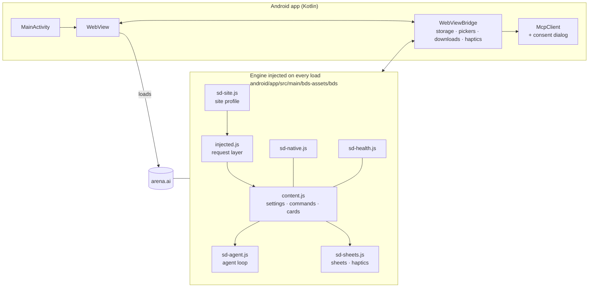

<div align="center">


# ArenaPilot

**arena.ai in your pocket — with an agent engine, memory, personas, skills and MCP tools built in.**

*অ্যারেনাপাইলট — arena.ai-এর জন্য একটি স্বতন্ত্র অ্যান্ড্রয়েড অ্যাপ।*

[](https://github.com/themuhammad-personal/Arenapilot/releases/latest/download/arenapilot-latest.apk)

[](https://github.com/themuhammad-personal/Arenapilot/actions/workflows/build-and-release-apk.yml)

[](LICENSE)

</div>

> [!IMPORTANT]
> **ArenaPilot is an independent, unofficial project.** It is not affiliated with, endorsed by or
> sponsored by arena.ai or any model provider. You use arena.ai through its own website, with your
> own account, under its own terms and privacy policy.

## What it is

ArenaPilot opens the real arena.ai website in a native Android shell and adds an engine on top:
a settings drawer, reusable context, tools and shortcuts that follow you from chat to chat. Nothing
is re-implemented — the page, your sign-in and the model picker stay Arena's own, and the app only
ever sends through the page's own composer. No API key. No login or captcha bypass.

The drawer, sheets and dialogs are painted with Arena's own colour tokens, so light and dark match
the website exactly.

## Highlights

| | |
|---|---|
| **Agent playbook** | Every conversation can carry rules for persistence, evidence over guesswork, plan → act → verify and honest completion. Switchable in *Chat & messages*. |
| **MCP tools** | Connect remote MCP servers; the model discovers and calls their tools. Every call asks for your consent first. |
| **Memory** | Facts you want remembered, stored on your phone. **Off by default**, an explicit opt-in. |
| **Personas & skills** | Reusable characters and task skills, applied per chat. |
| **Projects** | Files and instructions grouped per project and attached to a conversation. |
| **Slash commands** | Type `/` in the composer. Built-ins such as `/search`, `/new`, `/export`, `/compress`, `/summarize`; `/persona`, `/skill` and `/mcp` pick a persona, toggle a skill or switch an MCP server; add your own prompts and tags from *Advanced settings → Slash commands*. |
| **Files** | Photos, files and project folders from the **+** sheet. |
| **Custom CSS & backup** | Restyle the chat; export and import your settings and data. |
| **Reliable long tasks** | Rate limits, dropped streams and cut-off replies trigger a bounded recovery that respects *Stop*. |
| **Languages** | English, বাংলা, فارسی, Русский, Türkçe, 简体中文. |

## Design system

One token set drives every ArenaPilot surface: Arena's `--surface-*`, `--text-*`, `--border-*`,
`--brand-*` and `--interactive-*` variables are read live from the page, plus tokens for radius,
spacing, type, motion and layering (`android/app/src/main/bds-assets/bds/content.css`). Icons are one
inline-SVG family (24 grid, 2 px round stroke) — no network assets. Touch targets are 48 dp or
larger, focus is visible, and reduced-motion and reduced-transparency preferences are respected.

## Install

1. Download **[arenapilot-latest.apk](https://github.com/themuhammad-personal/Arenapilot/releases/latest/download/arenapilot-latest.apk)** on Android 8.0+.
2. Open it and allow installing from this source.
3. Sign in with your arena.ai account.

Every release is signed with the same certificate, so new versions install over the old one and keep
your data. A SHA-256 checksum (`arenapilot-latest.apk.sha256`) is published next to each APK.

## Architecture



## Privacy & security

- Your sign-in stays inside the app's WebView; the app never sees your password.
- MCP tool calls require explicit consent. Remote MCP servers are yours to choose and trust.
- Tool output, fetched pages and files are treated as untrusted data by the engine's instructions.
- Stored memory is off by default. Whatever context you enable is sent to arena.ai and to the provider
  of the model you picked.
- Release APKs are signed with the project's original key, kept only in GitHub Secrets. CI pins the
  published certificate fingerprint, so a build signed by any other key cannot ship.

## Develop

```bash
# Node 22, JDK 17, Android SDK 34
npm ci
npm test                      # engine, release-hygiene and model-list tests
npm run lint
npm run test:harness:arena    # the real engine in headless Chromium on a modelled Arena page
npm run android:stage-engine
cd android && ./gradlew testDebugUnitTest assembleDebug
```

| Path | Contents |
|---|---|
| `android/` | Kotlin app, Gradle build, CI helper scripts (`android/ci`) |
| `android/app/src/main/bds-assets/bds/` | The engine (JS/CSS) injected into the page |
| `android/app/src/test/` | JVM unit tests and engine tests (`js/`) |
| `tools/` | Headless-browser harness, Arena fixture, capture kit, icon generator |
| `models.json`, `models/` | Model list and its tests |
| `.github/workflows/` | Build, verify and release pipeline |
| `docs/` | Engineering notes and font licences |

## License

[MIT](LICENSE). The engine builds on the MIT-licensed *better-deepseek* by Çağrı DÜRÜ; see
[LICENSE](LICENSE) and `docs/licenses/`.
